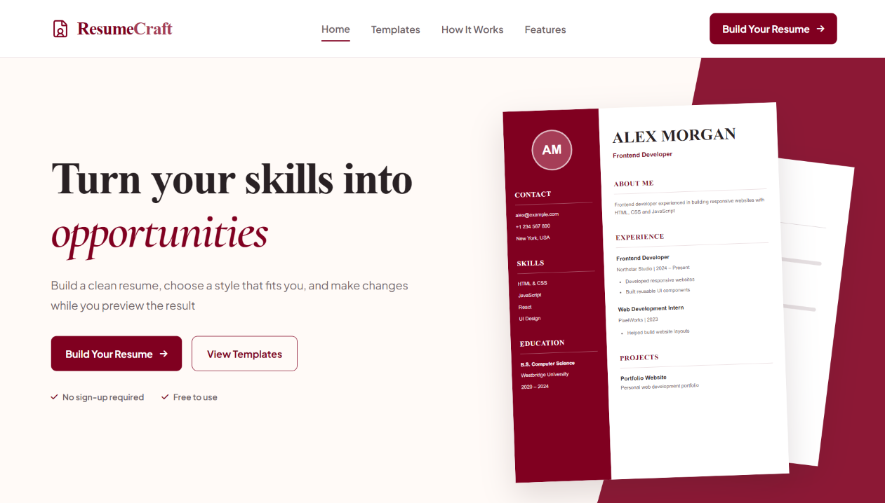
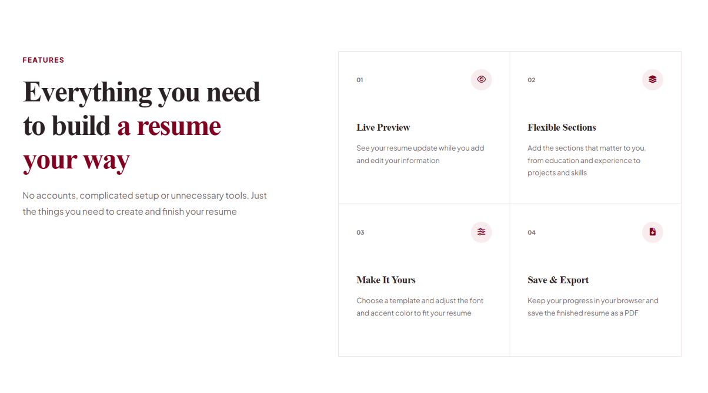
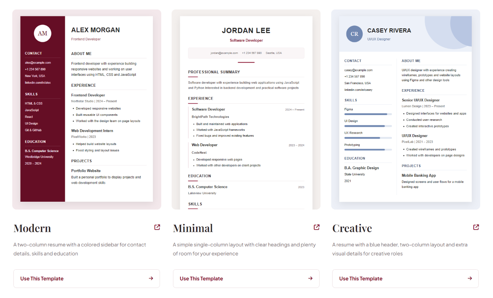
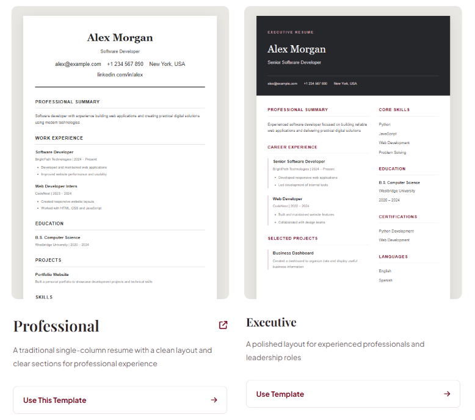
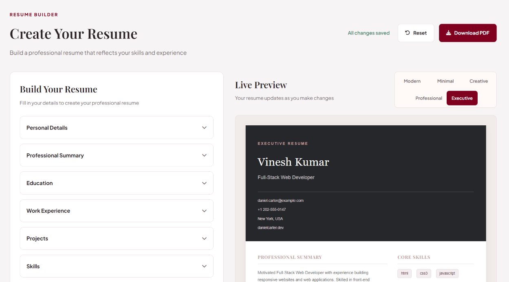
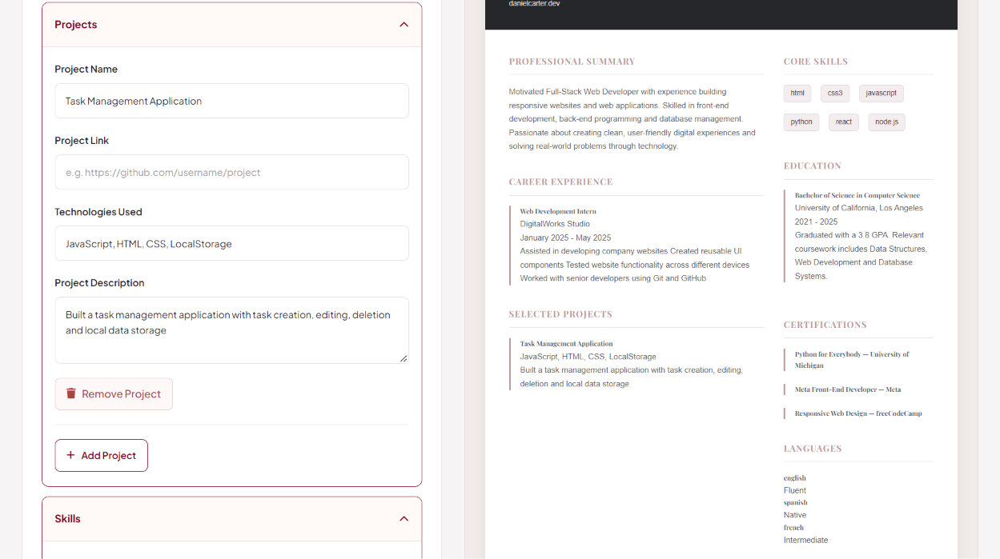
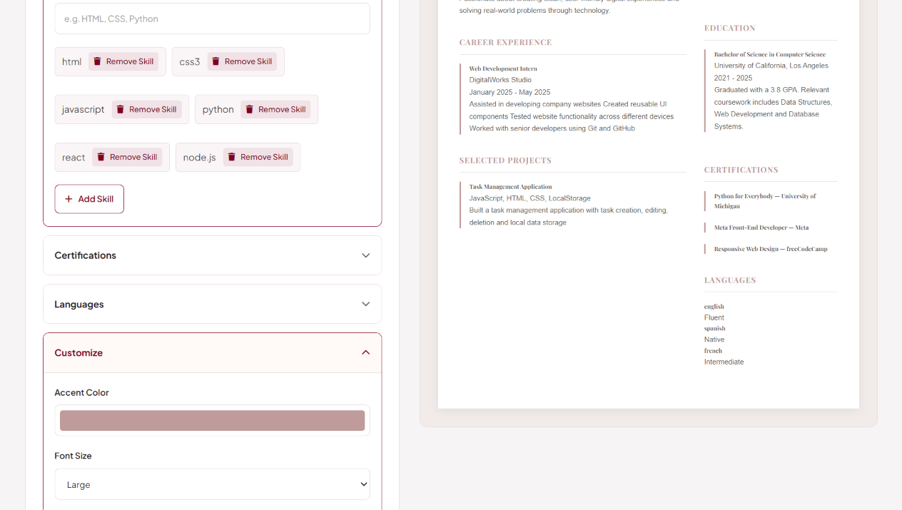
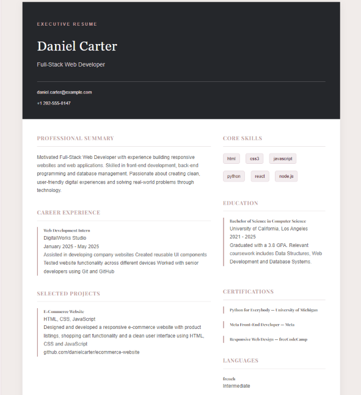

# ResumeCraft

ResumeCraft is a resume builder project that I created to make the process of building a professional resume easier. It comes with five different resume templates, so users can choose a design they like and add their personal information, education, work experience, projects and skills.

I built this project using HTML, CSS and Vanilla JavaScript. It includes a live preview that updates as users make changes, options to customize resume colors and font sizes, and LocalStorage to save resume data in the browser. Users can also switch between templates, edit their information and print or save their completed resume as a PDF.

## Live Demo

[Visit ResumeCraft](https://vineshkumar553.github.io/Resume-Craft/)

## Screenshots

### Homepage

### Templates Gallery

### Resume Builder

### Resume Preview

## Features

- **Five Resume Templates:** Choose from Modern, Minimal, Creative, Professional and Executive designs.
- **Live Resume Preview:** See changes instantly while entering or editing information.
- **Personal Information:** Add your name, job title, contact details and professional summary.
- **Dynamic Sections:** Add and remove multiple education entries, work experiences and projects.
- **Skills Management:** Add and remove skills while preventing duplicate entries.
- **Certifications and Languages:** Include certifications and languages in your resume.
- **Customization:** Change accent colors and font sizes to personalize the resume.
- **Auto Save:** Resume information is automatically saved using LocalStorage.
- **Data Restoration:** Previously saved information is restored when the page is reopened.
- **Reset Resume:** Clear saved information and start with a fresh resume.
- **PDF Export:** Print or save the completed resume as a PDF.
- **Responsive Design:** Use the website on desktop, tablet and mobile devices.

## Technologies Used

- HTML5
- CSS3
- JavaScript (Vanilla JavaScript)
- LocalStorage
- Font Awesome

## How to Use

1. Open the website using the Live Demo link.
2. Browse the available resume templates.
3. Choose a template and open the resume builder.
4. Enter your personal and professional information.
5. Customize the appearance of your resume.
6. Preview your resume and save it as a PDF.

## What I Learned

While building ResumeCraft, I got more practice with JavaScript DOM manipulation, event handling, dynamic elements, LocalStorage and responsive CSS. I also learned how to manage user input, update content in real time and handle browser printing for PDF export.

## Author

**Vinesh Kumar**